

Full stack engineer in Jakarta with 6+ years of building web and mobile products across travel, retail, and government-integrated platforms.

  

## Selected work

Click a card to open the case study, or expand **What I built** for the short version.

<table>
<tr>
<td width="50%" valign="top">

<a href="https://rmtemplate.com/projects/staigo">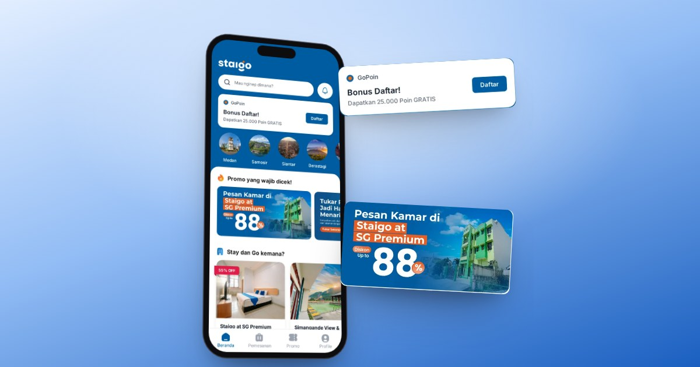</a>

<h3><a href="https://rmtemplate.com/projects/staigo">Staigo</a></h3>

Hotel booking platform, the rebuild of Helocus. 
NestJS · Nuxt.js · Socket.IO · Midtrans Core API · S3 · Docker

<b>What I built</b>

- One NestJS API for three Nuxt.js frontends: guest site, property extranet, and Staigo OS
- PMS integration with the Aiosell channel manager
- Live payment and booking updates over WebSocket
- Payments through the Midtrans Core API, files on S3

</td>
<td width="50%" valign="top">

<a href="https://rmtemplate.com/projects/beliumkm-b2b-ecommerce">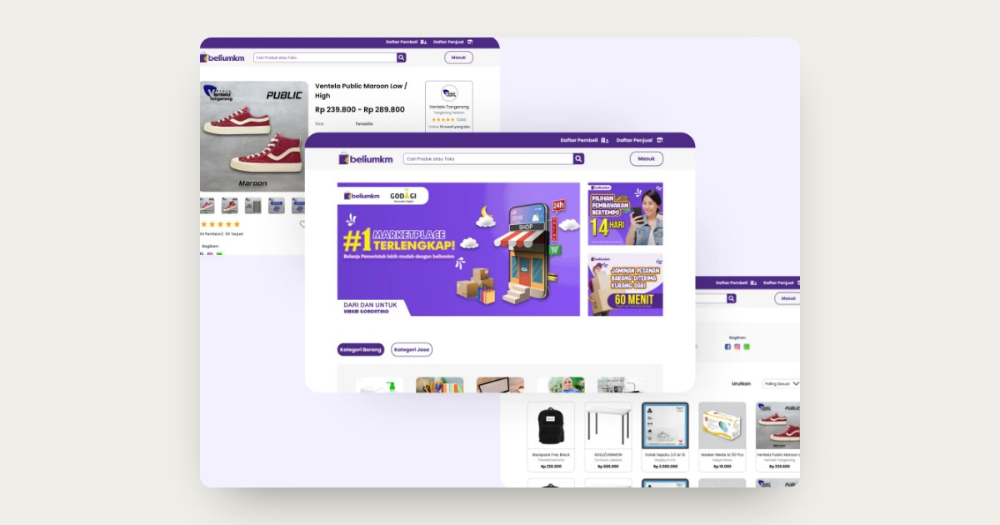</a>

<h3><a href="https://rmtemplate.com/projects/beliumkm-b2b-ecommerce">BeliUMKM</a></h3>

B2B e-commerce for government purchasing from UMKM suppliers. 
Laravel · Vue.js · MySQL · LKPP API

<b>What I built</b>

- RBAC for four roles: Seller, Buyer, Admin, and LKPP User
- RFQ and RFP workflows with supplier quotations
- LKPP and payment gateway integrations
- Internal shipping cost from buyer and seller locations

</td>
</tr>
<tr>
<td width="50%" valign="top">

<a href="https://rmtemplate.com/projects/helocus">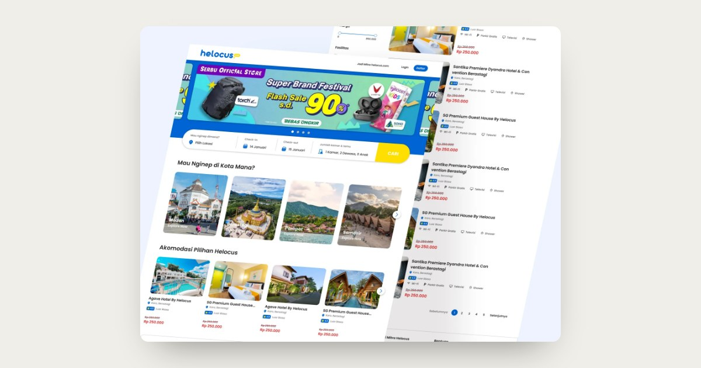</a>

<h3><a href="https://rmtemplate.com/projects/helocus">Helocus</a></h3>

Hotel booking platform for guests and hotel staff. 
Laravel · Vue.js · Bootstrap · Flutter · GetX

<b>What I built</b>

- Laravel API behind four clients
- Guest website and staff dashboard in Vue.js 3
- Guest app and staff app in Flutter with GetX
- PMS integration with the NextPax channel manager

</td>
<td width="50%" valign="top">

<a href="https://rmtemplate.com/projects/vasc-business-ecosystem">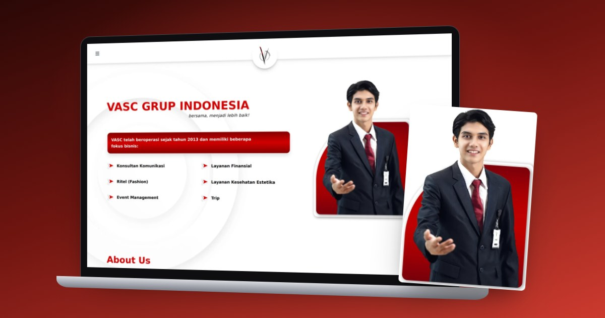</a>

<h3><a href="https://rmtemplate.com/projects/vasc-business-ecosystem">VASC</a></h3>

Company profile and employee systems for VASC Grup Indonesia. 
Next.js · React · Node.js · MySQL

<b>What I built</b>

- Public company profile at vasc.co.id
- Attendance system and other employee tools
- Kraja Batik: company profile, POS, tailoring tracker, and voucher check (<a href="https://rmtemplate.com/projects/kraja">case study</a>)

</td>
</tr>
<tr>
<td width="50%" valign="top">

<a href="https://rmtemplate.com/projects/ngolahraga-sports">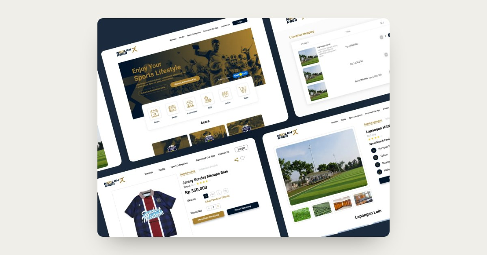</a>

<h3><a href="https://rmtemplate.com/projects/ngolahraga-sports">Ngolahraga</a></h3>

Venue rental, a sports shop, and tournaments in one platform. 
Vue.js · Laravel · Bootstrap

<b>What I built</b>

- Venue booking with available time slots
- Shop with catalog, cart, and checkout
- Tournament and event registration

</td>
<td width="50%" valign="top">

<a href="https://rmtemplate.com/projects/latis-education">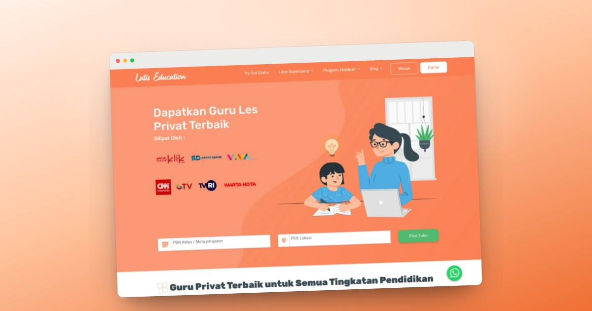</a>

<h3><a href="https://rmtemplate.com/projects/latis-education">Latis Education</a></h3>

Private tutoring marketplace. 
HTML · Bootstrap · JavaScript · Fetch API

<b>What I built</b>

- Sliced the designs into the public website
- Tutor and student panels without a frontend framework
- Data fetched from the Latis REST API

</td>
</tr>
</table>

## Explore

Prototypes, academic builds, and side projects. <a href="https://rmtemplate.com/explore">See all</a>

<table>
<tr>
<td width="33%" valign="top" align="center">
<a href="https://rmtemplate.com/explore/tukangin">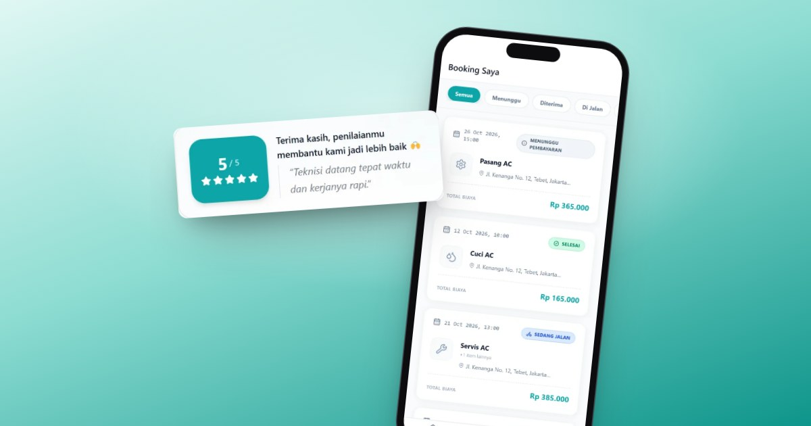</a> 
<a href="https://rmtemplate.com/explore/tukangin"><b>Tukangin</b></a> 
AC service booking · Laravel
</td>
<td width="33%" valign="top" align="center">
<a href="https://rmtemplate.com/explore/saku-kita">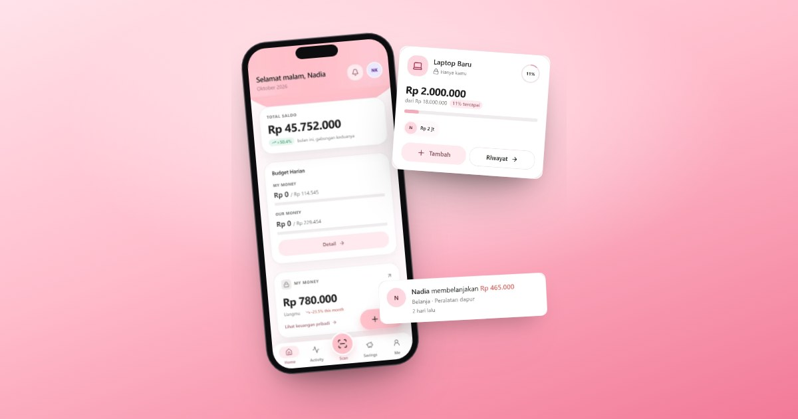</a> 
<a href="https://rmtemplate.com/explore/saku-kita"><b>Saku Kita</b></a> 
Shared finances · Nuxt + NestJS
</td>
<td width="33%" valign="top" align="center">
<a href="https://rmtemplate.com/explore/gadfix">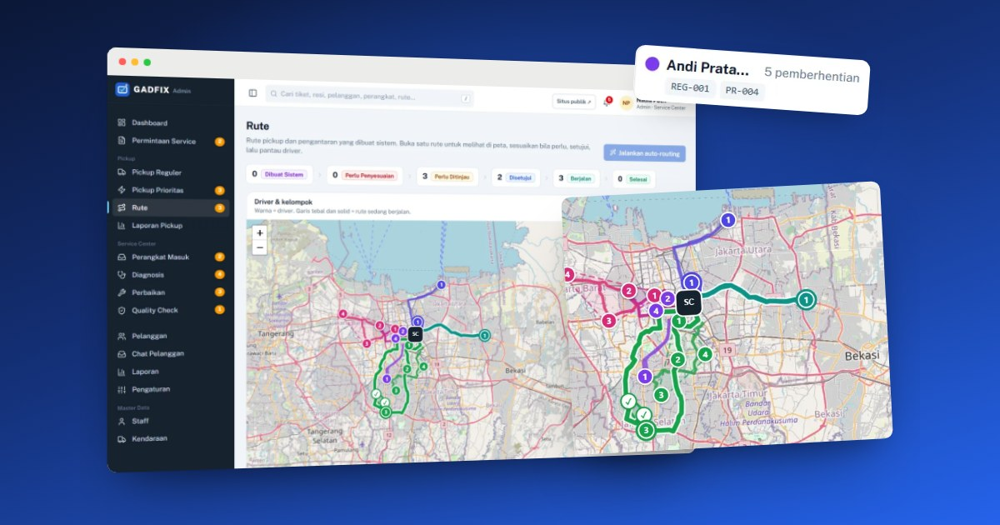</a> 
<a href="https://rmtemplate.com/explore/gadfix"><b>GADFIX</b></a> 
Gadget repair · Laravel + Vue
</td>
</tr>
<tr>
<td width="33%" valign="top" align="center">
<a href="https://rmtemplate.com/explore/rm-diagram">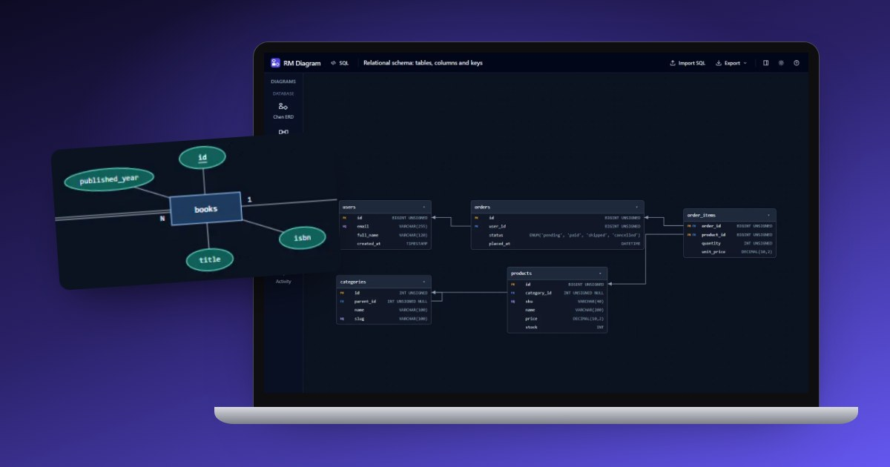</a> 
<a href="https://rmtemplate.com/explore/rm-diagram"><b>RM Diagram</b></a> 
SQL to ER diagrams · Nuxt
</td>
<td width="33%" valign="top" align="center">
<a href="https://rmtemplate.com/explore/lumina-library">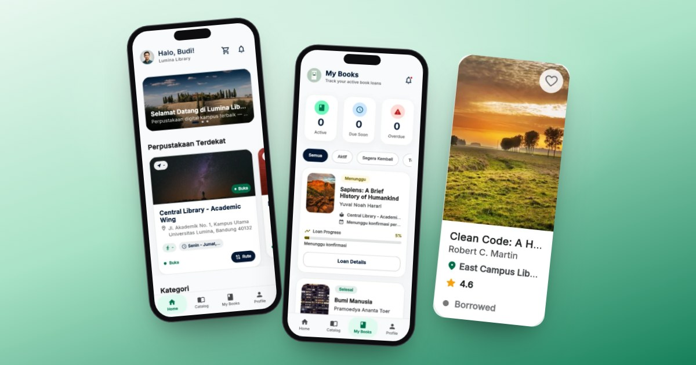</a> 
<a href="https://rmtemplate.com/explore/lumina-library"><b>Lumina Library</b></a> 
Campus library · Flutter
</td>
<td width="33%" valign="top" align="center">
<a href="https://rmtemplate.com/explore/catcare">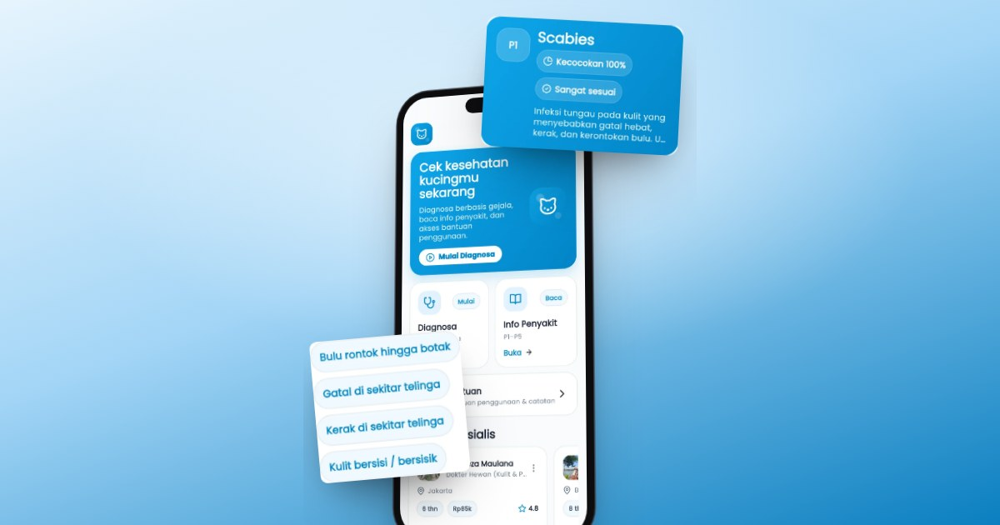</a> 
<a href="https://rmtemplate.com/explore/catcare"><b>CatCare</b></a> 
Expert system · Flutter
</td>
</tr>
</table>

## Tech stack

<b>Experience and education</b>

- **PT. Cakrawala Putra Nusantara**, since 2022: enterprise web and Android applications with Nuxt.js, TypeScript, Kotlin, C#, and SQL Server
- **Independent**, since 2019: full stack web and mobile delivery, platform modernization, and production maintenance
- **Universitas Bina Sarana Informatika**: Information Systems

More case studies at <a href="https://rmtemplate.com">rmtemplate.com</a>

